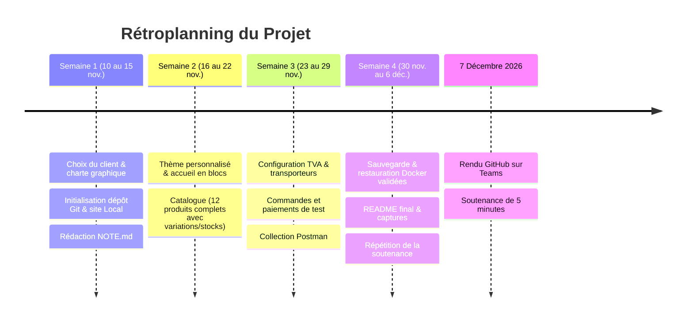

# 🚀 Projet Boutique E-Commerce (CMS & WooCommerce)

> **Module :** B3.2 CMS, E-Commerce & Mobile (M1 Info Dev)  
> **Échéance de rendu :** Lundi 7 décembre 2026 (avant le cours)  
> **Soutenance :** 5 minutes par groupe le 7 décembre 2026  
> **Barème clé :** *« Des commits réguliers, de plusieurs membres du groupe, avec des messages lisibles. Aucun secret dans le dépôt. »*

---

## 👥 1. Répartition des Rôles (Équipe de 3)

Pour éviter tout conflit sur Git et garantir que chaque membre dispose d'un historique de commits riche et équilibré, les responsabilités sont clairement réparties :

| Rôle | Membre assigné | Fichiers et dossiers sous sa responsabilité | Tâches principales |
| :--- | :--- | :--- | :--- |
| **Membre 1 : Identité & Design** | *Allan* | `charte/`<br>`theme/`<br>`README.md` *(section captures)* | • Définition de la charte graphique et du logo (SVG/PNG)<br>• Création du thème en blocs (Twenty Twenty-Five)<br>• Personnalisation de l'accueil, en-tête, pied de page et vue mobile (390px)<br>• Export du thème dans `theme/` et prises de captures |
| **Membre 2 : Cadrage Métier & Catalogue** | *Dibé* | `NOTE.md`<br>Catalogue WooCommerce<br>`README.md` *(sécurité & sources)* | • Rédaction de la note de cadrage `NOTE.md` (CMS vs sur-mesure + schéma Mermaid du modèle de données)<br>• Saisie des 12 produits (images, variations, stocks, promotions, UGS)<br>• Configuration TVA (20% / 5,5%), livraison, code promo et pages légales |
| **Membre 3 : DevOps, Docker & API** | *Emmanuelle* | `docker-compose.yml`<br>`scripts/`<br>`sauvegardes/`<br>`api/`<br>`.env.example` | • Création de l'infrastructure Docker (`wordpress`, `mariadb`, `wordpress:cli`)<br>• Écriture des scripts `scripts/sauvegarde.sh` et `scripts/restauration.sh`<br>• Conception et export de la collection Postman (`api/boutique.postman_collection.json`)<br>• Test de restauration de la boutique dans Docker |

---

## 📅 2. Planning des 4 Semaines (Rétroplanning)



* **Semaine 1 (10 au 15 nov.) :** Choix du client, charte graphique, dépôt Git, site Local, `NOTE.md`
* **Semaine 2 (16 au 22 nov.) :** Thème personnalisé, accueil en blocs, catalogue (12 produits complets)
* **Semaine 3 (23 au 29 nov.) :** TVA, transporteurs, paiements test, commande de test, collection Postman
* **Semaine 4 (30 nov. au 6 déc.) :** Sauvegarde/restauration Docker validée, README final, répétition soutenance
* **🎯 7 Décembre 2026 :** Rendu du lien GitHub sur Teams + Soutenance de 5 minutes

---

## 📁 3. Arborescence Stricte du Dépôt Git

> **Important :** Ne jamais versionner le cœur WordPress ni les fichiers d'installation complets. Seuls nos développements et configurations propres sont suivis.

```text
boutique-client/
├── README.md               # Présentation, captures d'écran, sécurité, relance
├── NOTE.md                 # Note de cadrage (2 pages) + modèle de données Mermaid
├── charte/                 # Logo (fond transparent) et charte graphique du client
├── theme/                  # Thème exporté depuis l'éditeur de site
├── api/                    # Collection Postman (boutique.postman_collection.json)
├── docker-compose.yml      # Configuration Docker (mariadb, wordpress, cli)
├── scripts/
│   ├── sauvegarde.sh       # Script d'export WP-CLI + compression médias
│   └── restauration.sh     # Script d'import SQL + wp search-replace
├── sauvegardes/            # Export SQL et archive des médias de démonstration
├── .env.example            # Gabarit des variables d'environnement (sans secrets)
└── .gitignore              # Exclusion stricte des secrets et fichiers lourds
```

### Configuration du `.gitignore` obligatoire

```gitignore
# Secrets et mots de passe (CRITIQUE pour l'évaluation)
.env
*.key
*.pem

# Ne JAMAIS committer le cœur WordPress ni les dossiers de Local
wp-admin/
wp-includes/
wp-content/uploads/
wp-config.php

# Fichiers systèmes parasites
.DS_Store
Thumbs.db
```

---

## 🌿 4. Règles de Travail Git au Quotidien (GitHub Flow)

> ⛔ **Règle absolue :** Ne jamais faire de `git push` directement sur la branche `main` !  
> Chaque membre travaille sur une branche dédiée et soumet une Pull Request (PR) revue par un pair.

### 1. Démarrer une nouvelle tâche

```bash
# Se placer sur main et récupérer les dernières modifications
git checkout main
git pull origin main

# Créer sa branche de fonctionnalité
git checkout -b feat/nom-de-la-tache
# Exemples : feat/charte-client, feat/note-cadrage, feat/docker-scripts
```

### 2. Enregistrer son travail avec des commits normalisés

```bash
git add .
git commit -m "feat(theme): mise en place de la palette et de l'en-tête"
git push -u origin feat/nom-de-la-tache
```

**Préfixes conventionnels recommandés :**
* `feat:` Nouvelle fonctionnalité ou nouveau composant
* `fix:` Correction d'un bug ou d'une erreur de configuration
* `docs:` Modification de la documentation (`README.md`, `NOTE.md`, charte)
* `style:` Ajustements CSS / blocs de mise en page
* `refactor:` Réorganisation de code ou de scripts sans changement fonctionnel

### 3. Valider et fusionner sur `main`

1. Ouvrir une **Pull Request** sur GitHub.
2. Un collègue effectue une relecture rapide et clique sur **Merge pull request**.
3. Chaque membre synchronise son dépôt local :
   ```bash
   git checkout main
   git pull origin main
   ```

---

## 🔄 5. Synchronisation de la Base de Données & des Médias

WordPress stocke sa configuration et son catalogue dans MariaDB/MySQL. Pour partager l'état du site entre équipiers :

### Quand un membre modifie WooCommerce ou le catalogue :

1. Exécuter le script d'export depuis la racine du projet :
   ```bash
   bash scripts/sauvegarde.sh
   ```
2. Committer les fichiers générés dans `sauvegardes/` et ouvrir une Pull Request :
   ```bash
   git add sauvegardes/
   git commit -m "feat(data): export mise à jour catalogue et réglages"
   git push origin feat/maj-catalogue
   ```

### Quand les autres membres récupèrent la mise à jour :

1. Mettre à jour la branche `main` :
   ```bash
   git checkout main
   git pull origin main
   ```
2. Appliquer les données dans leur environnement local :
   ```bash
   bash scripts/restauration.sh
   ```

---

## 🐳 6. Déploiement & Environnement Docker

### Prérequis

* [Docker Desktop](https://www.docker.com/products/docker-desktop/) installé et actif
* Fichier `.env` configuré à partir du gabarit `.env.example` :
  ```bash
  cp .env.example .env
  ```

### Lancement de l'environnement

```bash
# Démarrer les conteneurs (WordPress + MariaDB)
docker compose up -d

# Vérifier le statut des services
docker compose ps
```

* **Accès au site :** `http://localhost:8080` (ou port configuré)
* **Administration WordPress :** `http://localhost:8080/wp-admin`

---

## 📸 7. Captures d'Écran de la Boutique (Validation)

*(Insérer les captures d'écran finales requises pour le rendu)*

| Vue | Aperçu |
| :--- | :--- |
| **1. Page d'accueil (Desktop)** |  |
| **2. Fiche produit détaillée** *(variations, stock, prix)* |  |
| **3. Panier d'achat** |  |
| **4. Tunnel de commande / Validation** |  |
| **5. Vue Mobile responsive (390px)** |  |
| **6. Boutique restaurée sous Docker** |  |

---

## 🔒 8. Sécurité & Contrôle Anti-Fuite de Secrets

Avant tout push ou rendu final, s'assurer qu'aucun identifiant, clé d'API ou mot de passe n'a été indexé dans Git :

```bash
# Commande de vérification (ne doit renvoyer aucun résultat sensible) :
git grep -nE "ck_|cs_|password|DB_PASSWORD"
```

---

## ✅ 9. Checklist de Validation Finale (Avant Rendu du 7 Décembre)

- [ ] **Zéro secret dans Git :** La commande `git grep -nE "ck_|cs_|password|DB_PASSWORD"` ne retourne aucun secret.
- [ ] **Historique d'équipe équilibré :** Chaque membre a des commits réguliers et nominatifs sur GitHub.
- [ ] **6 captures d'écran minimum :** Accueil, fiche produit, panier, commande, vue mobile (390px) et environnement Docker opérationnel.
- [ ] **Test de restauration réussi :** La restauration via `scripts/restauration.sh` a été validée avec succès sur une autre machine.
- [ ] **Note de cadrage (`NOTE.md`) complète :** 2 pages, analyse comparative CMS vs sur-mesure et modèle conceptuel de données (diagramme Mermaid).
- [ ] **Collection Postman opérationnelle :** Située dans `api/boutique.postman_collection.json`.

---

## 🎤 10. Organisation de la Soutenance (5 Minutes Chrono)

> ⚠️ **Règle impérative :** Les 3 membres du groupe doivent obligatoirement prendre la parole.

| Temps | Sujet | Intervenant |
| :--- | :--- | :--- |
| **1 min** | Présentation du client, proposition de valeur et charte graphique | Allan |
| **2 min** | Démonstration en direct du parcours d'achat (panier, variations, promo, checkout) | Dibé |
| **1 min** | Démonstration technique (Docker, scripts ou appels API Postman) | Emmanuelle |
| **1 min** | Rétrospective, difficultés surmontées & axes d'amélioration | Tous les 3 |
